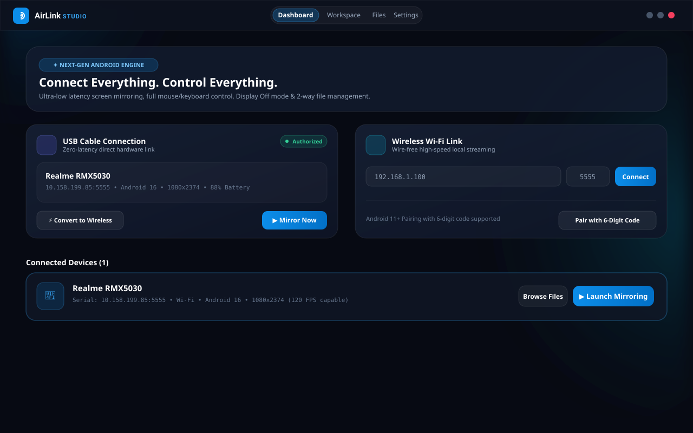
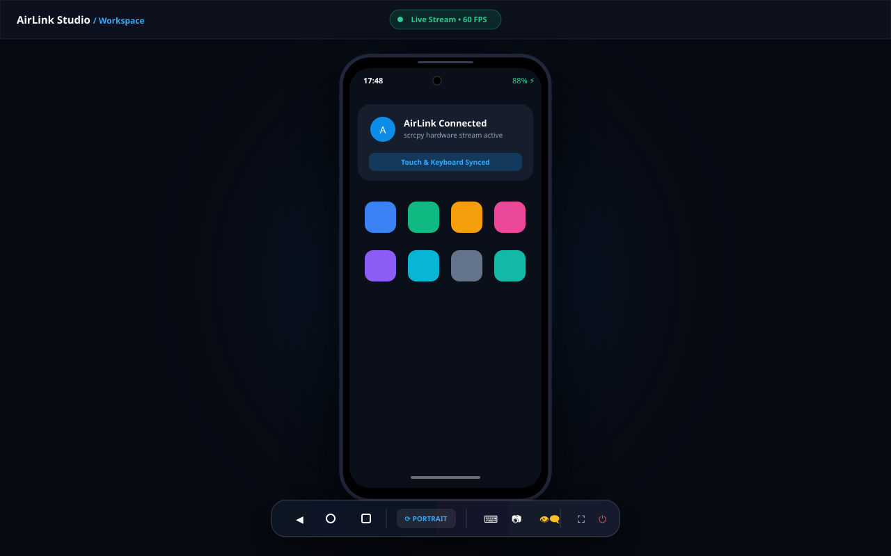
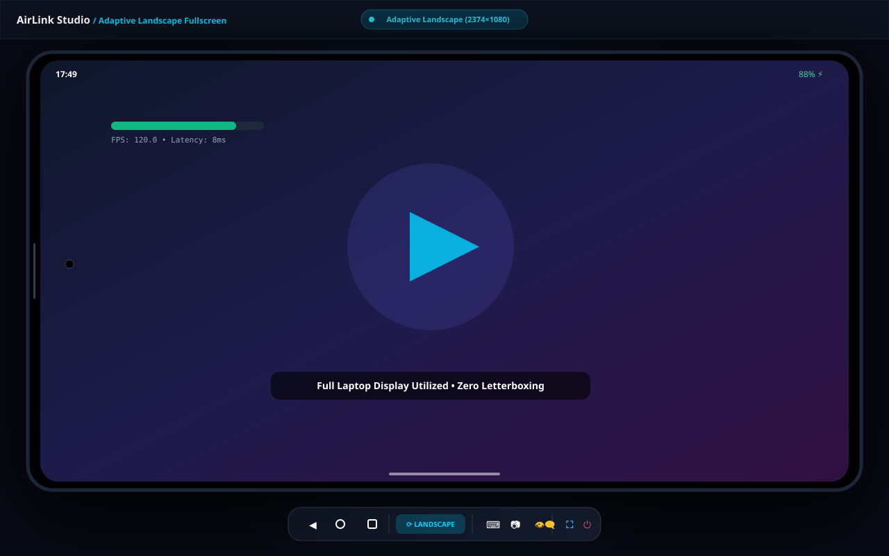
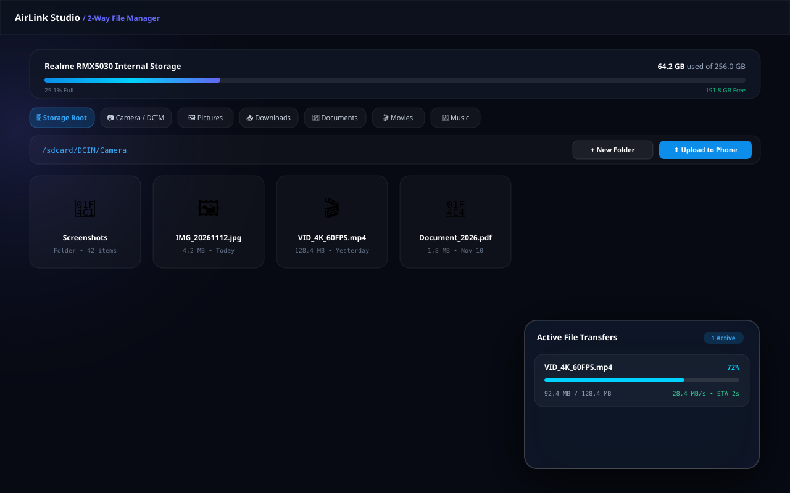

# AirLink Studio

> **Connect Everything. Control Everything.**  
> Ek modern open-source platform jo aapke Android phone aur Windows PC ko aapas mein jodta hai — ultra-low latency screen mirroring, full mouse/keyboard control, aur 2-way file transfer ke saath.

---

### 🌐 Bhasha Chunein / Language
**[English (English Documentation)](README.md)** | **[Hinglish (Roman Hindi)](#airlink-studio)**

---

<div align="center">

[](https://github.com/luckydx109/airlink-studio/releases/latest)
[](https://github.com/luckydx109/airlink-studio/releases/latest)
[](LICENSE)
[](https://github.com/luckydx109/airlink-studio/stargazers)
[](https://github.com/luckydx109/airlink-studio/issues)

<br/>

# [⚡ DOWNLOAD FOR WINDOWS (LATEST RELEASE)](https://github.com/luckydx109/airlink-studio/releases/latest)

| Package | Type | Description | Download Link |
| :--- | :--- | :--- | :--- |
| **AirLink-Studio-Setup.exe** | Installer (NSIS) | Desktop & Start Menu shortcut ke saath standard installer | [Download Setup (.exe)](https://github.com/luckydx109/airlink-studio/releases/latest/download/AirLink-Studio-Setup.exe) |
| **AirLink-Studio.exe** | Portable | Bina install kiye seedhe chalayein | [Download Portable (.exe)](https://github.com/luckydx109/airlink-studio/releases/latest/download/AirLink-Studio.exe) |
| **SHA256 Checksums** | Hash | File integrity verification | [SHA256SUMS.txt](https://github.com/luckydx109/airlink-studio/releases/latest/download/SHA256SUMS.txt) |

</div>

---

## 📸 Screenshots

<div align="center">
  
  <p><em>AirLink Studio Main Dashboard — USB aur Wi-Fi Dual Connection Hub</em></p>
  <br/>
  
  
  <p><em>Portrait Mode &amp; Adaptive Landscape Fullscreen (Games aur Videos ke liye)</em></p>
  <br/>
  
  <p><em>2-Way Android ⟷ Windows File Manager &amp; Drag-and-Drop Transfer</em></p>
</div>

---

## 🌟 Mukhyata Features (Key Highlights)

### 1. Dual Connection: USB aur Wireless Wi-Fi
- **USB Cable Se Direct Jodein**:
  - Automatic phone detection.
  - 1-click connect aur zero lag 60+ FPS streaming.
  - **1-Click Convert to Wireless**: Ek click mein phone ka Wi-Fi IP detect karke wireless mode ON karein, fir chahe toh USB cable nikaal dein!
- **Wireless Wi-Fi / Hotspot Connection**:
  - Direct IP & Port (`192.168.x.x:5555`) se connect karein.
  - **Android 11+ Pairing**: 6-digit pairing code ke saath wire-free pairing assistant.
  - Paired devices ki list yaad rakhta hai, taaki baar-baar setup na karna pade.
  - Screen streaming ke liye Bluetooth use nahi hota, direct high-speed local network stream hota hai.

### 2. Adaptive Landscape Fullscreen
- Phone ki orientation (Portrait ya Landscape) apne aap detect hoti hai.
- Jab koi game (jaise BGMI, Asphalt, COD) ya YouTube video landscape mein chalta hai, toh display apne aap expand hokar poori laptop screen ko use karta hai.
- **True Fullscreen (F11)**: Zero black bars, full display area, zero letterboxing!
- Aspect ratio kabhi kharab ya stretch nahi hota.
- Orientation badalne par phone disconnect nahi hota aur na hi scrcpy restart hota hai.

### 3. Mouse aur Keyboard Se Poora Control
- **Mouse Click**: Phone touch / tap.
- **Mouse Drag**: Swipe ya scroll gesture.
- **Mouse Scroll Wheel**: Fast vertical page scrolling.
- **Keyboard Typing**: PC ke physical keyboard se phone mein seedhe type karein.
- **Floating HUD Toolbar**:
  - Back, Home, Recent Apps buttons.
  - Volume Up, Volume Down, aur Power button.
  - Remote Text Input dialog.
  - High-resolution screenshot button (1-click mein capture karke Windows folder mein dekhein).

### 4. Display Off Mode (Screen Off Rakhein)
- Mirroring chalte waqt phone ki physical display aur backlight ko band kar deta hai.
- Isse phone ki battery bachti hai aur phone garam nahi hota.
- OLED screens ko burn-in se bachata hai.
- Keyboard ya mouse se jab chahein phone ko 'Wake' ya 'Sleep' kar sakte hain.

### 5. Advanced File Manager (Phone ⟷ PC)
- Phone ki internal storage, DCIM/Camera, Pictures, Downloads, Documents, Movies aur Music folders browse karein.
- **Phone se PC**: Files select karein aur Windows folder mein download karein (speed aur remaining time dikhata hai).
- **PC se Phone**: Windows se koi bhi file uthakar seedhe AirLink Studio par **Drag & Drop** kar dein!
- Kahi bhi koi file chupke se overwrite nahi hoti.

---

## 🚀 Step-by-Step Chalane Ka Tareeqa (How to Connect)

### USB Connection
1. Apne phone ke **Settings &rarr; About Phone** mein jayein aur **Build Number** par 7 baar tap karein.
2. **Settings &rarr; System &rarr; Developer Options** mein jakar **USB Debugging** ko ON karein.
3. Phone ko USB cable se computer se connect karein.
4. Phone screen par aane wale **"Always allow from this computer"** popup ko Allow karein.
5. AirLink Studio open karein. Phone Dashboard par dikhai dega.
6. **"Start Mirroring"** par click karein!

### Wireless Connection (Bina Cable Ke)
1. Phone aur PC ko **same Wi-Fi ya laptop ke hotspot** se jodein.
2. Phone ke **Developer Options &rarr; Wireless Debugging** ko ON karein aur uspe tap karein.
3. **"Pair device with pairing code"** par tap karein. Ek 6-digit code aur IP/Port dikhega.
4. AirLink Studio mein **"Pair with 6-Digit Code"** button dabayein, phone par dikhne wala IP, Port aur Code daalein.
5. Phone connect ho jayega aur agli baar sirf ek click se reconnect hoga!

---

## 🛠️ Developer Setup (Source Code Se Chalane Ke Liye)

Agar aap source code se build karna chahte hain:

```bash
# 1. Repository clone karein
git clone https://github.com/luckydx109/airlink-studio.git
cd airlink-studio

# 2. Dependencies aur bundled binaries install karein
npm install

# 3. Development mode mein start karein
npm run dev

# 4. Windows Installer (.exe) build karein
npm run build:win
```

Output `.exe` files `release/` folder mein ban jayengi.

---

## 📄 License & Attribution

- **AirLink Studio**: MIT License ke antargat open-source hai.
- **scrcpy Engine**: Copyright (C) 2018 Genymobile, Apache License 2.0.
- **ADB (Android Debug Bridge)**: The Android Open Source Project, Apache License 2.0.
- Poore third-party licenses ke liye dekhein: [THIRD_PARTY_NOTICES.md](THIRD_PARTY_NOTICES.md).
