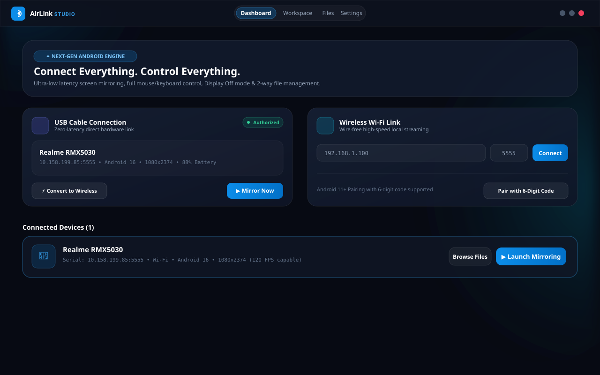
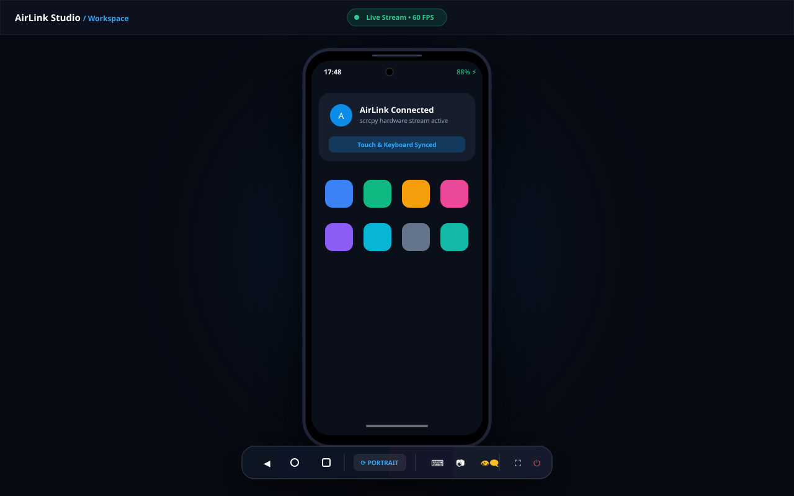
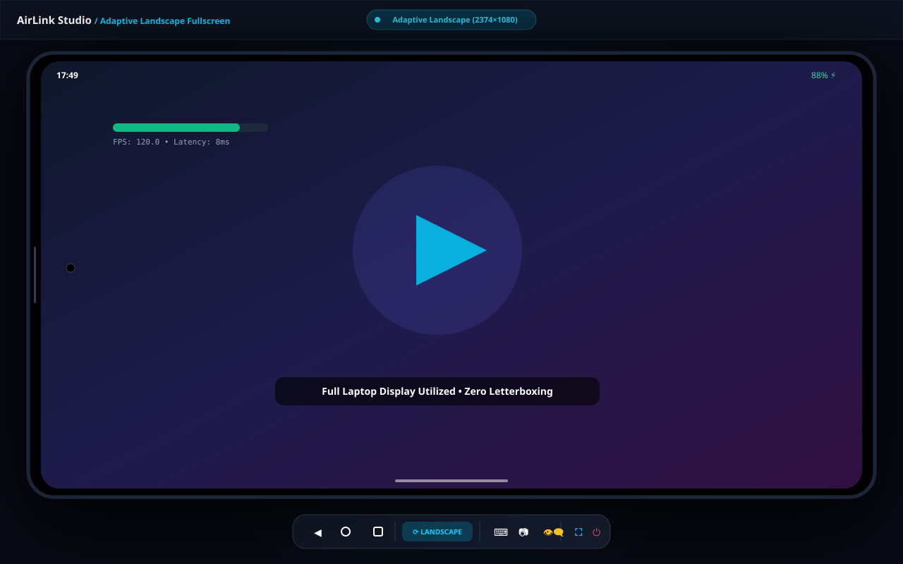
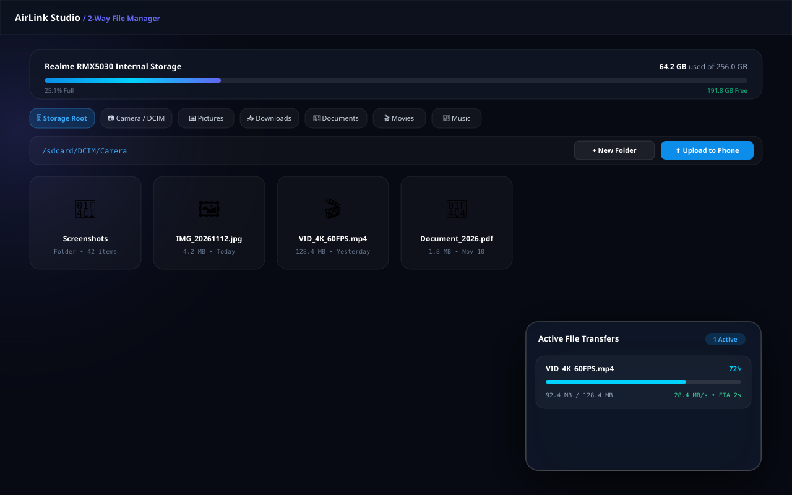

# AirLink Studio

> **Connect Everything. Control Everything.**  
> A modern open-source Android and Windows device connectivity platform featuring ultra-low latency screen mirroring, full remote mouse/keyboard control, Display Off mode, and seamless two-way file management.

---

### 🌐 Language Navigation / भाषा चुनें
**[English (Default)](#airlink-studio)** | **[Hinglish (Roman Hindi Documentation)](README-HINGLISH.md)**

---

<div align="center">

[](https://github.com/luckydx109/airlink-studio/releases/latest)
[](https://github.com/luckydx109/airlink-studio/releases/latest)
[](LICENSE)
[](https://github.com/luckydx109/airlink-studio/stargazers)
[](https://github.com/luckydx109/airlink-studio/issues)

<br/>

# [⚡ DOWNLOAD FOR WINDOWS (LATEST RELEASE)](https://github.com/luckydx109/airlink-studio/releases/latest)

| Package | Type | Details | Direct Download |
| :--- | :--- | :--- | :--- |
| **AirLink-Studio-Setup.exe** | **Installer (NSIS)** | Full installer with desktop & start menu shortcuts and auto-uninstaller | [⬇ Download Setup (.exe)](https://github.com/luckydx109/airlink-studio/releases/latest/download/AirLink-Studio-Setup.exe) |
| **AirLink-Studio.exe** | **Portable** | Self-contained single executable — run instantly without installation | [⬇ Download Portable (.exe)](https://github.com/luckydx109/airlink-studio/releases/latest/download/AirLink-Studio.exe) |
| **SHA256SUMS.txt** | **Checksums** | Cryptographic hash verification | [⬇ SHA256SUMS.txt](https://github.com/luckydx109/airlink-studio/releases/latest/download/SHA256SUMS.txt) |

</div>

---

## 📸 Visual Showcase

<div align="center">
  
  <p><em>AirLink Studio Main Dashboard — Dual USB &amp; Wi-Fi Connection Hub</em></p>
  <br/>
  
  
  <p><em>Portrait View &amp; Adaptive Landscape Fullscreen (Widescreen Video &amp; Gaming)</em></p>
  <br/>
  
  <p><em>2-Way Android ⟷ Windows File Manager &amp; Drag-and-Drop Transfer System</em></p>
</div>

---

## ✨ Key Features

### 1. Dual Connection Hub (USB & Wireless)
- **Direct USB Link**:
  - Automatic device detection via ADB.
  - One-click mirroring launch.
  - **1-Click Convert to Wireless**: Automatically detects the phone's Wi-Fi IP, restarts ADB in TCP mode on port 5555, connects wirelessly, and prompts you to safely unplug the USB cable!
- **Wireless Wi-Fi / Hotspot Link**:
  - Direct connection by Phone IP & Port (`192.168.x.x:5555`).
  - **Android 11+ Wireless Debugging Pairing**: Guided workflow for 6-digit codes and pairing ports (`adb pair`).
  - Securely remembers paired devices for instant 1-click reconnection.
  - Zero Bluetooth dependency for screen streaming.

### 2. High-Performance Screen Mirroring (scrcpy 3.1 Engine)
- **Adaptive Landscape Fullscreen**:
  - Real-time orientation tracking via `dumpsys window displays`.
  - Automatically expands the display in Landscape mode to utilize the maximum laptop workspace.
  - Borderless true fullscreen toggle (`F11` / `Escape`) for widescreen gaming and video playback.
  - Preserves exact native aspect ratio with zero stretching, distortion, or cropping.
- **Configurable Streaming**:
  - Resolution selector: Native, 4K (2160p), 2K (1440p), Full HD (1080p), HD (720p).
  - Frame rates: 30 FPS, 60 FPS, 120 FPS.
  - Bitrate: 4 Mbps to 32 Mbps adjustable video bitrates.
  - Codecs: H.264 (Universal), H.265 (HEVC), AV1.
  - Audio forwarding directly to Windows speakers.

### 3. Full Remote Control (Mouse & Keyboard)
- **Interactive Mouse Mapping**:
  - Mouse Click = Touch / Tap (dynamically calibrated in portrait & landscape).
  - Mouse Drag = Swipe / Gesture flick.
  - Mouse Scroll Wheel = Vertical scrolling.
- **Floating Liquid Glass HUD Toolbar**:
  - Soft Keys: Back (`KEYCODE_BACK`), Home (`KEYCODE_HOME`), Recents (`KEYCODE_APP_SWITCH`).
  - Hardware Buttons: Volume Up, Volume Down, Power (`KEYCODE_POWER`).
  - Remote Keyboard Text Input modal.
  - High-res screenshot capture with instant preview and folder access.

### 4. Display Off Mode (Physical Screen Power Down)
- Powers down the physical phone display and backlight while streaming and remote desktop controls remain fully operational on Windows.
- Dramatic battery savings and OLED burn-in prevention during prolonged usage.
- One-click remote Wake and Sleep controls.

### 5. Advanced 2-Way File Manager & Transfer System
- **Android Storage Explorer**:
  - Explore internal storage (`/sdcard`) and key categories: Camera/DCIM, Pictures, Downloads, Documents, Movies, and Music.
  - Multi-select actions: Batch Download, Batch Delete.
  - In-app media lightbox preview for photos, audio playback, and documents.
- **Two-Way Transfers**:
  - **Phone to Windows**: Select files, choose destination folder with native Windows file picker, track real-time progress, speed (MB/s), and ETA.
  - **Windows to Phone**: Send files directly to Android via file picker or **Drag & Drop** directly onto the application window!
  - **Non-Destructive**: Never silently overwrites duplicate files.
  - **Transfer History Log**: Review completed/failed transfers and open downloaded files in Windows Explorer with 1 click.

---

## 🚀 Quick Start Guide

### Step 1: Enable USB Debugging on Phone
1. Go to **Settings &rarr; About Phone** on your Android device.
2. Tap **Build Number** 7 times until you see *"You are now a developer!"*.
3. Navigate to **Settings &rarr; System &rarr; Developer Options**.
4. Enable **USB Debugging**.

### Step 2: Connect Phone
- **Via USB Cable**: Plug in your phone, accept the **"Always allow from this computer"** prompt, open AirLink Studio, and click **Start Mirroring**.
- **Convert to Wi-Fi**: Click **"Convert to Wireless"** on the USB card, then unplug the cable!
- **Via Wi-Fi Directly**: Use **"Pair with 6-Digit Code"** (Android 11+ Wireless Debugging).

---

## 🛠️ Building from Source

```bash
# 1. Clone repository
git clone https://github.com/luckydx109/airlink-studio.git
cd airlink-studio

# 2. Install dependencies & bundled binaries
npm install

# 3. Start development server
npm run dev

# 4. Package Windows Installer & Portable Executable
npm run build:win
```

Packaged installers will be generated in `release/`.

---

## 📚 Detailed Documentation

- **[Architecture & Technical Subsystems](docs/ARCHITECTURE.md)**
- **[Wireless Pairing & Hotspot Guide](docs/WIRELESS_PAIRING_GUIDE.md)**
- **[Troubleshooting & OEM Fixes (MIUI / HyperOS / Samsung)](docs/TROUBLESHOOTING.md)**
- **[Hinglish Documentation (Roman Hindi)](README-HINGLISH.md)**
- **[Contributing Guidelines](CONTRIBUTING.md)**
- **[Security Policy](SECURITY.md)**
- **[Changelog](CHANGELOG.md)**

---

## 📄 License & Attribution

- **AirLink Studio**: Licensed under the [MIT License](LICENSE). Copyright © 2026 Lucky Vishwakarma.
- **scrcpy Engine**: Copyright (C) 2018 Genymobile, Apache License 2.0.
- **Android Debug Bridge (ADB)**: The Android Open Source Project, Apache License 2.0.
- See [THIRD_PARTY_NOTICES.md](THIRD_PARTY_NOTICES.md) for complete licenses and credits.
